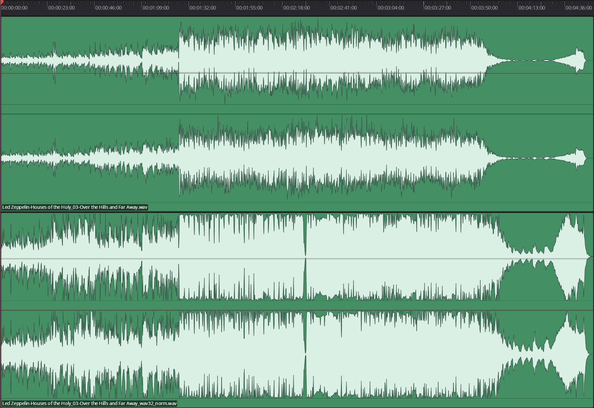
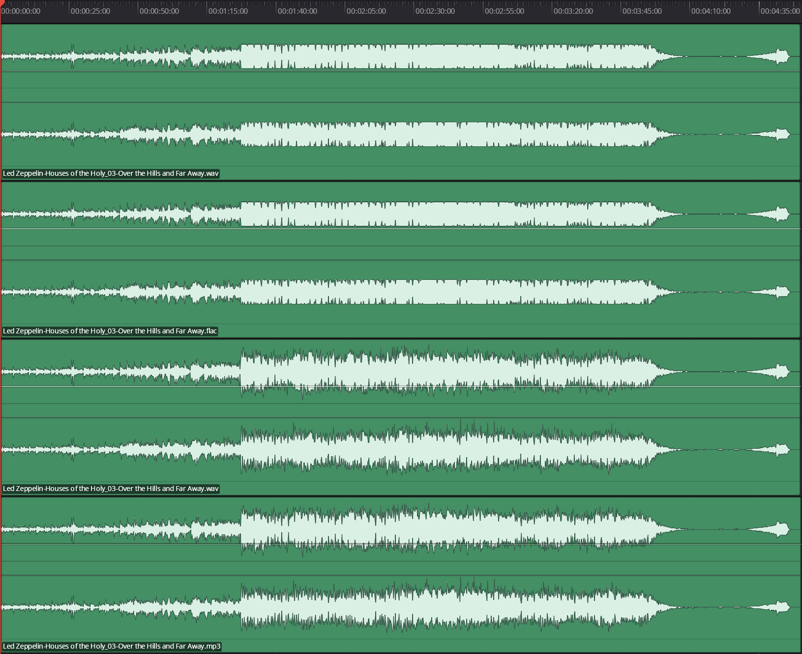

# Frequently asked questions

Short answers in plain words. For the full picture, see the [manual](MANUAL.md).

## The basics

**What is RangeForge?**
RangeForge is the evolution of a PowerShell script I wrote 8 years ago called [ALACBalancer](https://github.com/sleeperninja/ALACBalancer). Our music library is on a NAS in ALAC format played by a little Mac Mini, and we use a lot of smart playlists to maintain our personal house music system. Like any nerdy data hoarder, we also maintain rips of all of our CDs, SACDs and vinyl, some of which are saved as WAV/CUE or DSF (DSD) files. These are archival filesets, and not generally playable without processing. ALACBalancer has been my tool for setting a standard average volume while avoiding normalization of the music's waveform, but it always relied on other applications to split WAV/CUE rips, convert to ALAC and edit metadata. RangeForge combines all of the tooling into one application.

**Is it free?**
Yes. If it saves you time by keeping you from having to go through several different apps, buy me a Ko-fi ([ko-fi.com/sleeperninja42](https://ko-fi.com/sleeperninja42)) to show some love. Just to reiterate: the app is free, and a donation does NOT unlock any secret paywalled features.

**Which computers does it run on?**
Windows is the main target and the one it is tested on. macOS (Apple Silicon and Intel) and Linux builds are set up but have not been tried by hand yet.

**Does it change my original files?**
Not by default. New files are written first, to temporary names. Only when every song from a source was written without an error are they moved into place. If anything fails, they are deleted and your originals are exactly as they were. Deleting an original is a separate option, off by default, and it asks first.

## Volume

**What is "volume balancing"?**
Making songs play at the same *perceived* loudness, without distorting them. It is based on loudness standards (LUFS), not on peak level.

**Why not just "normalize"?**
The word covers two things. *Peak* normalizing raises each song until its loudest instant hits the same level, which keeps the waveform but leaves songs at very different volumes. Tools that go further to hit a loudness target often add compression or limiting, and that flattens the difference between the loudest and quietest parts of the music, giving it that old weird "radio compression" sound. Some people may like that, and that's fine, but I consider it lost waveform data. I want to hear that waveform turned into analog music, so RangeForge does neither: one gain per song, and the peak ceiling decides how far it can go. If there's a massive desire for the squashed version, I could add it as an option, but you're really losing out on the dynamic range that makes music dramatic.

The visualization is a dramatic example of a waveform squashed to be louder, but even gentler squashing changes the waveform and therefore the music. RangeForge would prefer not to be the cause of that.

**What are LUFS, LRA and true peak?**
- **LUFS:** how loud it sounds. Streaming services and broadcasters each use their own target level, but if every song aims at the same number, you don't get a really quiet song followed by a really loud one.
- **LRA (loudness range):** how much the loudness varies throughout a song. This is the Range column.
- **True peak (dBTP):** the real highest level, including between samples. It matters for avoiding distortion, and sometimes the playback peak is louder than the peaks in the waveform!

**Why is a song quieter than my target, with a `*`?**
Its loudest moment would have gone over your peak ceiling if it were raised any more. The ceiling wins, so the song stays a little quieter. That is the setting doing its job. If you do not mind the risk, turn Peak Protection off.

**Why do MP3 and 32-bit float WAV turn Peak Protection off?**
Because testing showed that MP3 and 32-bit float WAV preserve the waveform above 0 dBTP, RangeForge turns Peak Protection off for them automatically. (Your own setting is not changed, and it comes back when you pick another format.) If your target loudness is reasonable (−16 to −18 LUFS), even the highest dynamic range music is unlikely to cause any jarring artifacts. AAC and Opus preserve peak data only to a degree: soft clipping and waveform degradation happen above 0 dB to save space, so they are left out of the automatic switch-off.

The visualization below shows the result of transcoding a song to −10 LUFS with Peak Protection off, then reducing the volume manually in DaVinci Resolve to see the condition of the peak data that was above 0 dB during the transcode.

**What happens to peaks above 0 dB when Peak Protection is off?**
It depends on the format and how loud you want your music to sound. At higher loudness (about −10 LUFS), 16-bit and 24-bit WAV, FLAC and ALAC hard clip peak data flat--just like in the Led Zeppelin Remasters releases. This is the basis for the Loudness War; the race to make music as loud as possible on Compact Disc. Given more room to breathe (about −18 LUFS), hard clipping is likely to be minimal and unnoticeable, but RangeForge sides with preserving the waveform and gives you the option to turn Peak Protection off if you prefer.

## Formats

**Which format should I choose?**
- **ALAC:** Apple Lossless Audio Codec. It's Apple's version of FLAC (it's even got a similar acronym).
- **FLAC:** Free Lossless Audio Codec. It's fabulous. Great lossless compression, support for multichannel surround, high bit depth and sample rates--it's basically ubiquitous in the world of playback. I use it for surround pretty regularly.
- **WAV:** for editing. 32-bit float WAV keeps peaks above 0 dB exactly.
- **AAC, MP3, Opus:** lossy, for small files. They throw away a lot of data through psychoacoustic optimization. Prefer ALAC or FLAC when you can. MP3 does do a neat peak preservation trick like 32-bit float WAV, but that's about it.

**What do V0 to V4 mean for MP3?**
LAME's variable bitrate (VBR) options go from 0 to 9, with V0 meant to be virtually indistinguishable from the source, and V9 being ultra-tiny and kind of, sort of sounding like the source. RangeForge offers V0 to V4, each placed beside its closest match among the constant bitrate (CBR) options. I wouldn't use anything below V1, but a few of them are there for you.

**Why can't I pick another sample rate for Opus?**
Opus is always 48 kHz. MP3 caps at 48 kHz; AAC at 96 kHz.

**Why is Quad missing for ALAC and MP3?**
ALAC does not have a true quad layout (it turns four channels into five, with a silent center). MP3 is limited to two channels. The rest allow Quad.

**Why won't it write my 5.1 file as MP3?**
MP3 is limited to two channels, so only stereo and mono mixdowns work. Set Channels to Stereo or Mono and it will write.

**Which surround downmix should I use?**
**Standard** for most music. **Standard + bass** gives a slightly denser acoustic low end, if the source has meaningfully implemented LFE. **Front pair only** is for sources where the front left and right already are the stereo mix. Center boost behaves inconsistently from source to source, so it hasn't been implemented.

**I chose "source" for a DSD file and got 88.2 kHz. Why?**
DSD is not sampled like normal audio: it is a very fast stream of single bits, so it has no ordinary sample rate or bit depth to keep. "Source" falls back to the two values in Settings under DSD Format, 88.2 kHz and 24-bit by default, but Sample Rate can be raised as high as 192 kHz.

**What about DSD?**
RangeForge can convert _from_ DSD, but DSD isn't as simple as a transcode or conversion. DSD is the product of Digital Signal Processing (DSP) tools that algorithmically (when well tuned) separate signal from noise and encode it as single-bit samples at an astonishingly high sample rate. If your heart is set on converting something to DSD it's a pretty interesting rabbit hole--but it's not something we're doing here.

**Is the sample-rate conversion good?**
Yes. It was checked on real hi-res music against a very-high-precision reference, and the difference is below the 16-bit noise floor. Loudness and true peak are unchanged.

## Names, tags and the internet

**Does it go online by itself?**
No. Everything online starts off. Turn on **Metadata API** in Settings to let it look things up.

**What is the blue "Radio" tag?**
It marks songs that charted on the Billboard Hot 100 (it is called Radio because a song that charted was a song people heard on the radio). It needs no key. In Settings you can turn it off, rename it, or only tag songs that reached a position you choose (1 to 100; 100 means any song that charted). RangeForge keeps a local copy of the chart history and downloads it again only when a newer one exists. The history comes from the community-run [billboard-hot-100](https://github.com/mhollingshead/billboard-hot-100) project on GitHub. Thank you to the people who keep it up to date!

**Do I need a Last.fm key?**
Only if you want album genres from Last.fm. RangeForge does not come with a key. Getting your own is free (Settings has a link: create one for an app on Last.fm). The key stays on your computer, in its credential store.

**Why isn't there a key built in?**
A key baked into a program can be copied by anyone, and Last.fm can cancel it for everybody. Yours is free, takes a minute, and is only ever yours. Please don't share it.

**Why doesn't Last.fm give me song-specific genre tags?**
If you are asking this, you may be as upset as I am to find out that you can ask Last.fm for song information, but you get NO SONG-SPECIFIC TAGS. MusicBrainz actually has the same problem, so it's clearly a thing. The most infuriating part is that RangeForge sends you to the page, and you can see the tags RIGHT THERE. The API doesn't share those tags--at least not yet. For now, just add those tags from the page with **Add a tag…**, where it's possible to add a list separated by commas, semicolons or line breaks.

**The names are wrong. What do I do?**
Right-click the song or album and choose **Album & track names…**. You can type names, fetch a track list from Last.fm, or paste one from a store page. It also copes with long filenames from purchased vinyl digital downloads (barcode, track number, artist, title, ISRC). Names that are only a guess from the file name show in italics.

**Does it change where a CUE album is cut?**
No. The split points and track numbers come from the disc rip and are never changed. Only the words (titles, artist, album) can be replaced.

## Settings and trouble

**Where are my settings?**
RangeForge creates settings files in your user profile (on Windows, `%APPDATA%\RangeForge`): `settings.json`, `presets.json` and the measurement cache. Deleting `settings.json` puts everything back to the defaults.

**Is there a batch auto-convert?**
There was the idea of an Auto Mode checkbox. I let go of the idea once I felt the reality of integrating Last.fm for metadata and album tags along with Billboard Hot 100 "Radio" tagging. There's too much metadata value, and too many opportunities where RangeForge can't guarantee the _right_ metadata, so you'll want to eyeball it before you click **Run**.

**It said something I do not understand.**
Open the log (**Show Logs**). It says what the program is doing, step by step, including exactly what was sent to any online service.

**How do I report a bug?**
Open an issue on the project page: [github.com/sleeperninja/RangeForge/issues](https://github.com/sleeperninja/RangeForge/issues). Say what you did, what you expected, and include the log.
