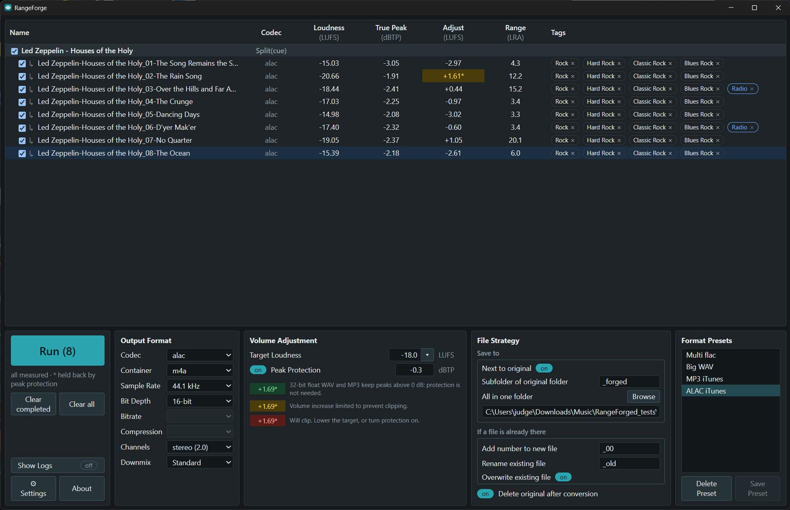
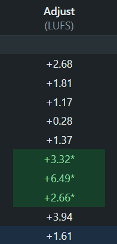
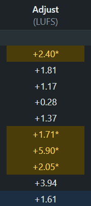
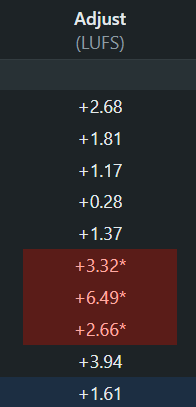
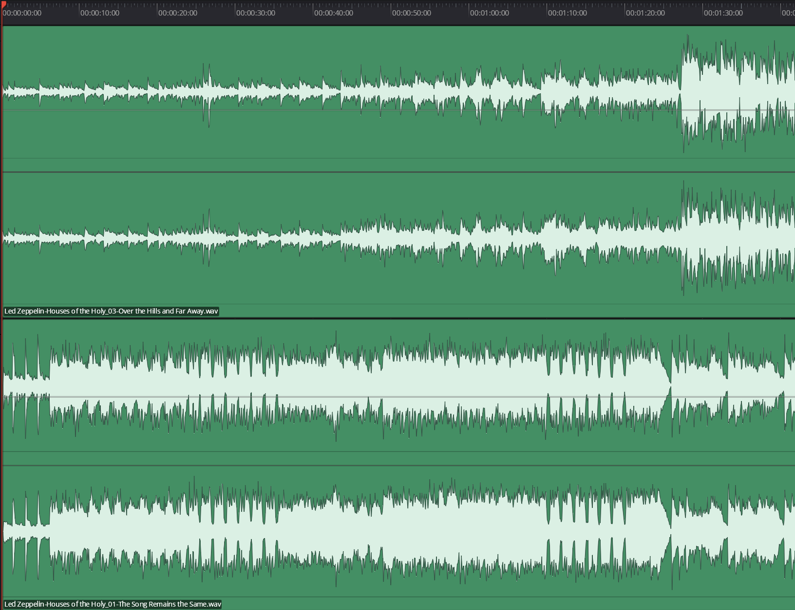
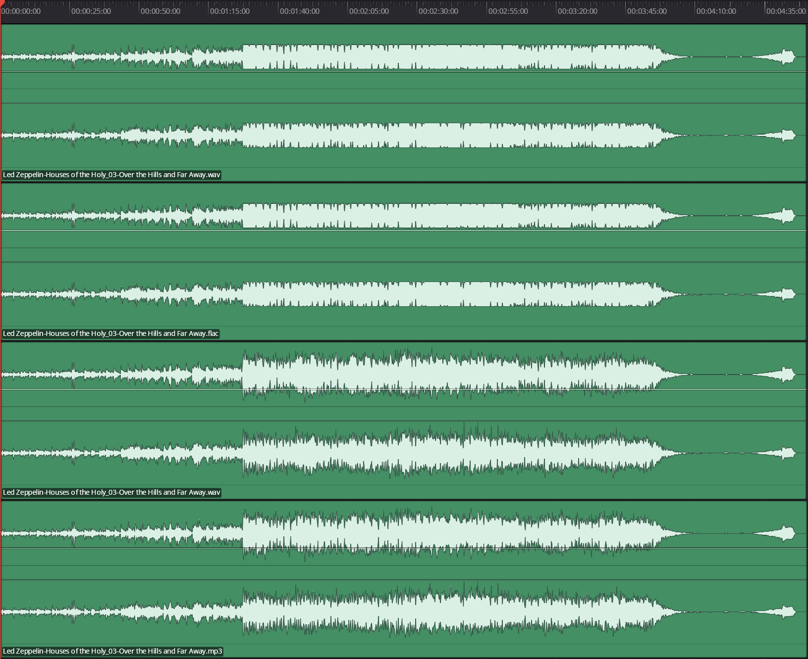
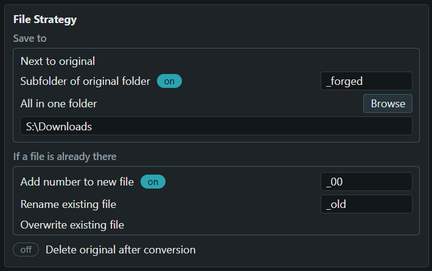

# RangeForge manual

*For version 1.0.0. This is the plain-words manual: how to use the program, and how it decides things. Questions people ask often are in [FAQ.md](FAQ.md). What is planned is in [ROADMAP.md](ROADMAP.md).*

---

## What RangeForge does

You drop in albums and songs. RangeForge measures how loud each one is, **once**, and shows you what it would change. You pick a target volume and an output format. Then you press **Run**, and it splits CUE albums into songs, sets each song's volume, tags it, names it, and writes clean files. Nothing is written until you press Run.

### The one promise

RangeForge changes how loud each song is, and nothing else about the music. It never squashes the dynamics, never limits the peaks, and never touches an original until every new file has been written safely.

---

## Quick start

1. **Drop** files, folders or CUE sheets onto the window (or use **Add files…** / **Add folder…**). Each album is measured once. RangeForge reads a few folders deep, and the folder you write into is skipped, so what you already wrote is not added again.
2. **Look** at the table. **Loudness** is how loud a song is now, **Adjust** is what RangeForge would do to reach your target, and a `*` with a color means something about the song's peak (see *Volume Adjustment* below).
3. **Choose** a target volume, an output format, and where the files go. Changing the target updates the table instantly.
4. **Fix names** if needed: right-click a song or album and choose **Album & track names…**.
5. **Run.** Your originals stay as they were, unless you chose to delete them.

  

---

## The window

### The list

Each row is a song or a file, and files detected as the same album automatically group. Albums that come from two different sources (like a stereo folder and a surround folder) show as two versions of the same album. A CUE album (one big audio file plus a small `.cue` text file that says where each song starts) shows as an album row with its songs underneath.

| Column | What it tells you |
| --- | --- |
| Name | The album or song. A single file shows the name it will be written as, in italics when that name is a guess from the file name. |
| Codec | The format it came in as, or the format it will be written as. `Split(cue)` on an album means it will be cut into songs. |
| Loudness | How loud the song is now, in LUFS. |
| True Peak | The highest point the sound reaches, in dBTP. |
| Adjust | How much louder or quieter RangeForge will make the song. |
| Range | How much the loudness rises and falls within the song, in LU (LRA). A small number is steady; a big one is very dynamic. |
| Tags | Genre labels (see *Genres and tags*). |

Click a song to pick it, Ctrl-click to add or drop one, Shift-click for a range. The tick boxes switch songs or whole albums in or out of the next run. Right-click for more. **Clear completed** and **Clear all** are under the Run button.

### The control panel

**Run area (left).** **Run (n)** writes the files; the number is your selection, or everything if nothing is picked. Under it are **Clear completed** (removes the albums that have been written) and **Clear all**. Further down: **Show Logs**, and **Settings** and **About** side by side.

**Output Format.** What the new files will be: **Codec**, **Container**, **Sample Rate**, **Bit Depth**, **Bitrate**, **Compression**, **Channels** and **Downmix**. "Source" means "keep what the file has". A control that does nothing for the combination you chose stays in place, shows nothing, and is dimmed.

**Format Presets** (the last column). Saved sets of output, volume and File Strategy settings. Pick one to fill them in; **Save Preset** keeps what you have now under a name, including where the files go and what happens to a name that is taken. So a preset can mean "write 32-bit float WAV into a `_WAV32` subfolder" or "write ALAC over the originals and delete them". The built-in presets have no File Strategy, and choosing one leaves yours alone. Choosing a preset that deletes originals still asks first when you press Run.

**Volume Adjustment.** **Target Loudness** (for example −22 LUFS; type a number, or open the drop-down for common ones such as −16, −18, −22 and the broadcast standards; a positive number you type is made negative when you leave the box), and **Peak Protection** (a switch, with its ceiling beside it, −0.6 dBTP to start with). Under them is a key to the colors in the Adjust column: **green** means the new peak goes above 0 dB and the format (32-bit float WAV or MP3) keeps it; **yellow** means the volume increase was limited to prevent clipping; **red** means the song will clip, because protection is off and the format cannot hold the peak.

**File Strategy.** Where the files go, what to do when a name is taken, and whether to delete the original. See *What happens when you press Run*.

**Settings** has the file name patterns, the DSD fallback, the **Metadata API** switch (online lookups, off to start with) and the Last.fm key. **About** has the version, the manual, the downloads page and the Ko-fi link. Changes in Settings take effect when you press **Save**; **Cancel** drops them. Only the Last.fm key buttons (Save key, Forget) and Clear saved answers act at once.

---

## How a song's volume is set

**Adjusting, not normalizing.** Most tools that "normalize" push each song until its single loudest instant reaches the same level. Two songs can do that and still sound very different in volume, because one has a few sharp peaks and the other is loud all the way through. RangeForge sets how loud each song *sounds* (its LUFS) and treats the loudest instant only as a limit it will not cross. That is why the column says **Adjust**, and why the program talks about a *target*, not a normal.

**It listens once.** When you drop files in, each one is decoded and measured a single time: its loudness (LUFS), its true peak, and its loudness range. The result is saved on disk against what the file *contains*, not its name or date, so a renamed or moved copy of the same album costs nothing the second time.

**Then it is just arithmetic.** You choose a target. Each song's gain is the target minus its measured loudness. Change the target and the table updates at once, because nothing needs to be measured again.

**One gain per song.** The gain is applied once, to the sound in memory, before it is encoded. A song written at 0 dB is sample for sample identical to its source.

**The peak ceiling is the hard limit.** Raise a quiet song by a large gain and its loudest moments could go over full scale. So there is a ceiling (−0.6 dBTP to start with), and a song is never boosted past it. If a song runs out of headroom, it stays *below* the target and is marked `*`. That is the setting working as intended: it is why someone asking for −10 LUFS with a 0 dB ceiling gets a wide spread of volumes.

**No compression, and an opt-in at most.** The program does not compress or limit by default. If a limiter is ever added, it will be a switch that is off, that only touches songs the ceiling would otherwise hold back, and that says exactly which songs it touched.

---

## Changing the sound: rate, depth, channels, formats

Changing the sample rate, the bit depth or the number of channels is not "volume work". These conversions change the samples out of necessity, so they are allowed alongside the gain-only rule. The order is always:

> **convert → measure the converted sound → apply the one gain → encode**

The gain and the peak ceiling are worked out on the sound that is actually written.

### Sample rate

The choices are source, 44.1, 48, 88.2, 96, 176.4 and 192 kHz. Resampling uses a long, careful filter, and was checked on real hi-res music: the audible band comes out within about −100 dB of a very-high-precision reference, which is below the 16-bit noise floor, so nobody can hear a difference. True peak and loudness are unchanged. Opus is always written at 48 kHz, MP3 stops at 48 kHz and AAC at 96 kHz; a source above that is brought down to the nearest rate of the same family (96 kHz becomes 48 kHz for MP3, and 192 kHz becomes 96 kHz for AAC).

### Bit depth and dither

Going to 16 bits means rounding, and plain rounding adds a faint distortion that follows the music. Triangular dither replaces it with a steady, very quiet noise. So RangeForge dithers whenever it has changed the signal and is writing 16 bits: a gain, a drop from 24 bits, a new sample rate, or a channel mix. A file left untouched at 0 dB is never dithered, so it stays bit-exact. 24-bit output needs no dither.

### Channels

Mixing six channels down to two is a lot like turning a color photo into black and white. There is more than one honest way, and the results are not the same. So the choice has two parts.

**Channels:** Source, Quad (4.0), Stereo (2.0) or Mono (1.0). It only ever reduces: asking for as many channels as the file has, or more, means "source", and nothing is upmixed. Files with more than 6 channels (7.1 and up) are always written as they are; a matrix processor downmixes those better than we would.

**Downmix** (live only when Channels is not source):

| Style | What it does | When it fits |
| --- | --- | --- |
| **Standard** (default) | Center and surrounds go into left and right at −3 dB; the LFE is dropped | Keeps the balance of the original mix |
| **Standard + bass** | The same, with the LFE added at −3 dB | Adds a little weight to the low end on some music |
| **Front pair only** | Left and right as mixed; center and surrounds discarded | When the front pair already *is* the stereo mix |

Quad keeps the four corners and folds the center into the fronts. Mono is the average of the standard stereo mix.

**Why the downmix is measured on its own.** On real 5.1 music, the standard stereo downmix came out between −0.6 and +1.6 LU of the six-channel loudness, and its true peak was 2.6 to 4.9 dB *higher*. The six-channel measurement cannot be trusted for a stereo file. So a downmix is measured after the mix, the gain and ceiling are worked out on that, and the table shows the result. Changing Channels or the Downmix style measures the loaded files again.

**Limits.** ALAC cannot hold quad (it would make five channels with a silent center), and MP3 holds only two channels, so Quad is not offered for them. A file with more than two channels cannot be written as MP3 until Channels is Stereo or Mono.

**Not offered, on purpose:** a center boost (it changes the sound a lot, and inconsistently) and Dolby-style matrix encodings.

### Lossy formats

AAC, MP3 and Opus have a **Bitrate** picker. For MP3 it includes LAME's variable-rate steps (V0 best, V4 smallest) placed where their average rate falls among the steady ones, with 320 kbps second best and V0 on top; nothing below 128 kbps is offered. Opus is variable-rate already, so its numbers are targets. Lossy files are never dithered, and the one gain still comes before the encoder. **FLAC** has a **Compression** level, 0 (largest file) to 8 (smallest), 5 to begin with; it changes the size and the time, never the sound.

### Peaks above 0 dB (Peak Protection off)

With Peak Protection on, nothing is pushed past the ceiling. With it **off**, a gain can carry the loudest moments past full scale (0 dB). What happens to them depends on the file. This was checked with test tones and with real songs, not just assumed.

- **16-bit and 24-bit WAV, FLAC and ALAC: hard clipping.** These formats store whole numbers, and the largest is full scale. Anything above it is clipped flat at 0 dB. Therefore, **Peak Protection is on by default for these formats.**
- **32-bit float WAV: kept exactly.** Floating-point samples have no ceiling at 0 dB, so peaks remain as written. This is the one format here where the whole waveform survives. Lower the volume later, in any editor that reads float, and the peaks are still there, which is what makes it useful for soundtrack assets and anything that will be mixed again. Therefore, **Peak Protection switches itself off for 32-bit float WAV.**
- **MP3: kept, and treated like 32-bit float WAV.** The LAME encoder takes the waveform as floating-point, so nothing is clipped on the way in, and the file reads back with its peaks intact (psychoacoustically compressed, but not soft or hard clipped). Side by side, the waveforms closely resemble the 32-bit float ones. Therefore, **Peak Protection switches itself off for MP3.**
- **AAC and Opus: soft clipping.** These encoders also take floating-point sound, and the files read back with peaks over 0 dB, but the peak data is significantly distorted. Our best guess is that the encoder treats everything above 0 dB as lower-priority data to save space. Therefore, **Peak Protection is on by default for these formats.**

In short: if peaks above 0 dB matter, write 32-bit float WAV (or MP3 if you need a small file). For anything else, leave Peak Protection on.

### DSD

DSD cannot be written back out as it is, so it is converted. It is written in your Output Format like any other file (codec, container, bitrate, compression, channels, downmix). Only two things have a fallback, **Sample Rate** (defaults to 88.2 kHz) and **Bit Depth** (24-bit). To adjust, look in **Settings → DSD Format**. Each applies on its own, and only where your Output Format says "source".

---

## Who a song is

Lookups, file names and tags all depend on a song's artist, title and album. They come from the best source available, in this order, and **anything you type always wins**:

1. A **CUE sheet**, for songs split from an album image.
2. The **tags** in the file.
3. A **guess** from the file's name and folders. These show in italics, so you know the name is a guess. The guesser understands names like `Artist - Title`, `07 - Title`, folders like `Artist - Album (1973) [FLAC]`, and the long vinyl-download names (barcode, track number, artist, title, ISRC).
4. **Typed in by you.**

### Album & track names

Right-click a song or album and choose **Album & track names…**. It is one dialog for an album and all its songs. Fix the artist, album and album artist, and give each song a title by typing, or from the album's track list (from Last.fm, or pasted from a store page). The list is lined up with the songs by title first, then by track number, then, if what is left is equal in number, by order. Each row says how it was paired, and weak pairings are marked. The program makes the first guess; you correct it, and nothing is applied until you press **Save**.

### CUE albums

A CUE sheet's **split points and track numbers** come from reading the disc, so they stay exactly as they are. The **words** in it (title, artist, album) are only starting values, because the database entry that filled them in might be wrong. What you type replaces the sheet's words in the written tags, the file names and the rows, and never changes where the songs are cut or their numbers.

### What the program checks and what it leaves to you

It splits, measures, plans, tags and names as well as it can from what it has, and makes correcting quick. It does not pretend the data is perfect, because a disc can carry the wrong title, a database entry can be for the wrong album, and a file name could have come from anywhere. We're all human and make mistakes, so RangeForge does its best to make them easy to fix.

---

## Genres and tags

Everything online starts **off**. Turn on **Metadata API** (in Settings) to let RangeForge look things up.

- **Radio tag:** a blue tag on songs that charted on the Billboard Hot 100 ("Radio" because a song that charted was a song people heard on the radio). It needs no key. In **Settings** you can switch it off, give it another name (Radio is the default), and set how high a song must have charted: a position from 1 to 100, where 100 (the default) means anything that charted and 1 means only number ones. RangeForge keeps a local copy of the chart history and only downloads it again when a newer one exists. The history comes from the community-run [billboard-hot-100](https://github.com/mhollingshead/billboard-hot-100) project, with thanks.
- **Last.fm album genres:** need a Last.fm key. RangeForge does not come with one, and does not use anyone else's. Getting your own is free: create one for an app on Last.fm (**Settings** has a link), paste it into **Settings**, and tick **Use Last.fm**. The key is kept in the computer's own credential store, never in a file. Tags are filtered to the useful ones (opinions, habits, places, decades and the artist's name are dropped), up to three per album, and each album is asked about once and remembered for weeks.
- **Song-level tags:** Last.fm does not give these to programs. Right-click a song → **Open song tags page on Last.fm**, and add the ones you want with **Add a tag…**. It takes one tag or a list separated by commas, semicolons or line breaks. Tags you add are green.
- When you press Run, the genre tag is written as the plain tags, comma separated, with the Hot 100 tag last, for example `Classic Rock, Hard Rock, Funk Rock, Radio`. Each tag chip has a **×** to remove it.

---

## What happens when you press Run

1. Each song is encoded to a temporary file (it ends in `.rangeforge-part`) next to where it will end up.
2. Only after every song from a source has been written without a single error are the temporary files moved into place.
3. If anything fails, the temporary files are deleted and your originals are exactly as they were.

The **File Strategy** is three separate choices:

- **Save to:** *Next to original*, *Subfolder of original folder* (you type the name; `_forged` to start with), or *All in one folder*.
- **If a file is already there:** *Add number to new file* (`_00`, `_01`…), *Rename existing file* (it gets a suffix like `_old`, and the new file takes the name), or *Overwrite existing file*. A name is only ever changed when it would clash.
- **Delete original after conversion:** off to start with. It happens last, only when every song from that source was written. An album with a song left out keeps its source.

Overwriting and deleting ask for confirmation first. The question has a **Don't ask me again** box, and Settings can turn it back on.

Your settings are remembered between sessions: File Strategy, Output Format, Volume, the file name patterns and the DSD fallback.

---

## Where RangeForge keeps things

Settings, presets and the measurement cache live in the program's own folder under your user profile (on Windows, `%APPDATA%\RangeForge`). Nothing is stored next to your music except the files you ask it to write. API keys are in the system credential store (Credential Manager or Keychain), not in these files.

RangeForge includes FFmpeg to read and write audio. See [THIRD_PARTY_NOTICES.md](THIRD_PARTY_NOTICES.md).

---

## Words you will see

- **CUE album:** one big audio file plus a `.cue` text file that says where each song starts.
- **LUFS:** how loud something sounds to a person. Every song is moved toward the same target.
- **True peak (dBTP):** the highest point the sound reaches, including between samples. Too high means distortion.
- **LRA (Range):** how much the loudness rises and falls within a song.
- **Codec / container:** how the audio is compressed (ALAC) and the file type that holds it (`.m4a`).
- **Sample rate, bit depth, channels:** the sound's detail level, its precision, and how many speakers it is for (2 is stereo, 6 is 5.1).
- **Bitrate:** how much data per second a lossy file uses. Higher is better and bigger.
- **DSD:** a rare high-end format that has to be converted to be edited.
- **Preset:** a saved set of output settings.

---

## Supporting RangeForge

RangeForge is free to use. If you love how much time it saves you, you can buy me a Ko-fi ([ko-fi.com/sleeperninja42](https://ko-fi.com/sleeperninja42)). It is optional and nothing is locked behind it.
